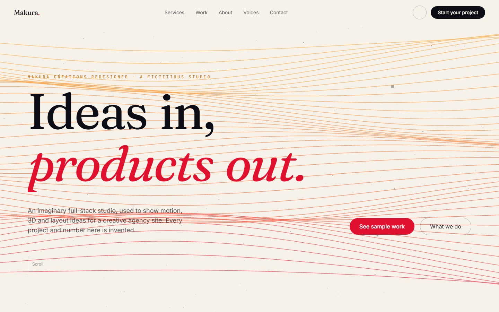
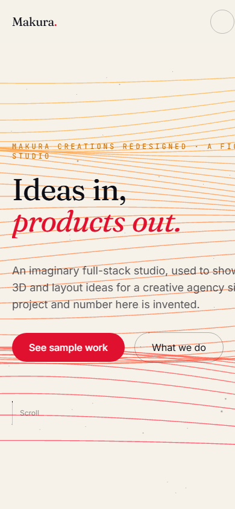

# Makura Creations Redesigned

**A fictitious, motion-first agency website concept, built to showcase design and animation ideas.**

> **This is a fictitious project.** "Makura Creations Redesigned" is an invented studio. Every client, project, testimonial, address, phone number, statistic and piece of copy is made up for demonstration. It does not describe, represent or replace any real company, and nothing here is affiliated with one. The project images are original abstract artwork created for this demo.

- **Live site:** https://makura-site.vercel.app
- **Mirror on GitHub Pages:** https://ali-sazzad.github.io/Makura-Site-Redesign/





## Tech stack

- Next.js 16 (App Router) with React 19 and TypeScript
- Tailwind CSS 4
- GSAP 3 with ScrollTrigger
- Three.js, choreographed with Theatre.js
- Motion (`motion/react`), anime.js and Lenis

## Motion

| Where | What | Built with |
| --- | --- | --- |
| Hero background | A field of coloured threads. Camera, twist and colour are keyframed in a Theatre.js sequence that scrolling scrubs through | Three.js, Theatre.js, ScrollTrigger |
| Services | On desktop the six sample services scroll sideways while the section stays pinned. Phones get a stacked layout | GSAP `matchMedia`, ScrollTrigger (pin + scrub), `ServicesMobile` |
| Work | Sample project cards tilt toward the cursor with spring physics | Motion (`useSpring`, `useTransform`) |
| Voices | Sample quotes rotate every six seconds | Motion (`AnimatePresence`) |
| About | Counters count up | anime.js |
| Whole page | Smooth, inertial scrolling | Lenis |
| Cursor | A custom cursor, only on devices with a fine pointer | `matchMedia` |

The Three.js scene checks `prefers-reduced-motion`. Light and dark themes are available from the header toggle.

## Sections

Hero, sample-client marquee, Services, Work, About, Voices, Contact.

## Getting started

```bash
npm install
npm run dev
```

Then open http://localhost:3000.

```bash
npm run build   # production build
npm run lint    # ESLint
```

## Deployment

- **Vercel** builds the app as a normal Next.js project.
- **GitHub Pages** is deployed by `.github/workflows/pages.yml` on every push to `main`. Setting `GITHUB_PAGES=true` switches `next.config.ts` to a static export served from the `/Makura-Site-Redesign` base path.

## Project layout

```
app/          layout, page, global styles, icons
components/   Hero, Services, Work, About, Voices, Contact, ThreadScene, Cursor, Nav, ...
lib/          theatre.ts (the Theatre.js scroll sequence)
public/work/  original abstract artwork for the sample projects
```

## Credits

Design and build by [Sazzad Ali](https://github.com/ali-sazzad). All content is invented; do not present it as a real company's information.
