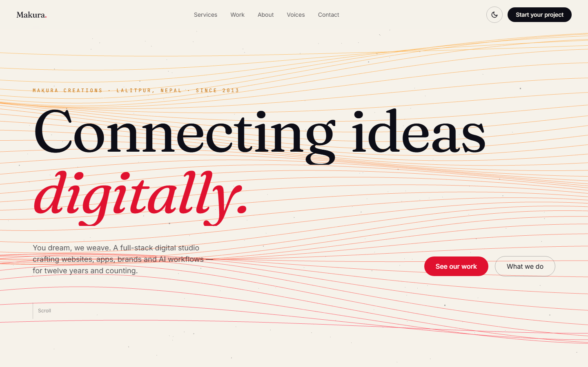
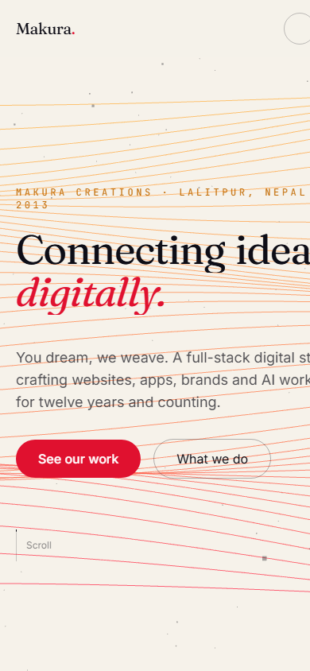

# Makura Creations: website redesign

A motion-first redesign of the [Makura Creations](https://makuracreations.com) site, a full-stack digital studio in Lalitpur, Nepal. One long page that introduces the studio, its services and its client work, built to feel cinematic without getting in the way of the content.

- **Live site:** https://makura-site.vercel.app
- **Mirror on GitHub Pages:** https://ali-sazzad.github.io/Makura-Site-Redesign/





## Tech stack

- Next.js 16 (App Router) with React 19 and TypeScript
- Tailwind CSS 4
- GSAP 3 with ScrollTrigger
- Three.js, choreographed with Theatre.js
- Motion (`motion/react`), anime.js and Lenis

## Motion

| Where | What | Built with |
| --- | --- | --- |
| Hero background | A woven field of coloured threads. Camera, twist and colour are keyframed in a Theatre.js sequence that scrolling scrubs through | Three.js, Theatre.js, ScrollTrigger |
| Services | On desktop the six services scroll sideways while the section stays pinned. Phones get a stacked layout instead | GSAP `matchMedia`, ScrollTrigger (pin + scrub), `ServicesMobile` |
| Work | Client cards tilt toward the cursor with spring physics | Motion (`useSpring`, `useTransform`) |
| Voices | Client quotes rotate every six seconds | Motion (`AnimatePresence`) |
| About | The studio's stat counters count up | anime.js |
| Whole page | Smooth, inertial scrolling | Lenis |
| Cursor | A custom cursor, only on devices with a fine pointer | `matchMedia` |

The Three.js scene checks `prefers-reduced-motion`. Light and dark themes are available from the header toggle.

## Sections

Hero, client marquee, Services, Work, About, Voices (testimonials), Contact. Client work links through to the matching case study on makuracreations.com.

## Getting started

```bash
npm install
npm run dev
```

Then open http://localhost:3000.

```bash
npm run build   # production build
npm run lint    # ESLint
```

## Deployment

- **Vercel** builds the app as a normal Next.js project.
- **GitHub Pages** is deployed by `.github/workflows/pages.yml` on every push to `main`. Setting `GITHUB_PAGES=true` switches `next.config.ts` to a static export served from the `/Makura-Site-Redesign` base path.

## Project layout

```
app/          layout, page, global styles, icons
components/   Hero, Services, Work, About, Voices, Contact, ThreadScene, Cursor, Nav, ...
lib/          theatre.ts (the Theatre.js scroll sequence)
public/work/  client case-study images
```

## Credits

Redesign and build by [Sazzad Ali](https://github.com/ali-sazzad). Client names, logos and quotes belong to their owners and are used here as a portfolio demonstration.
